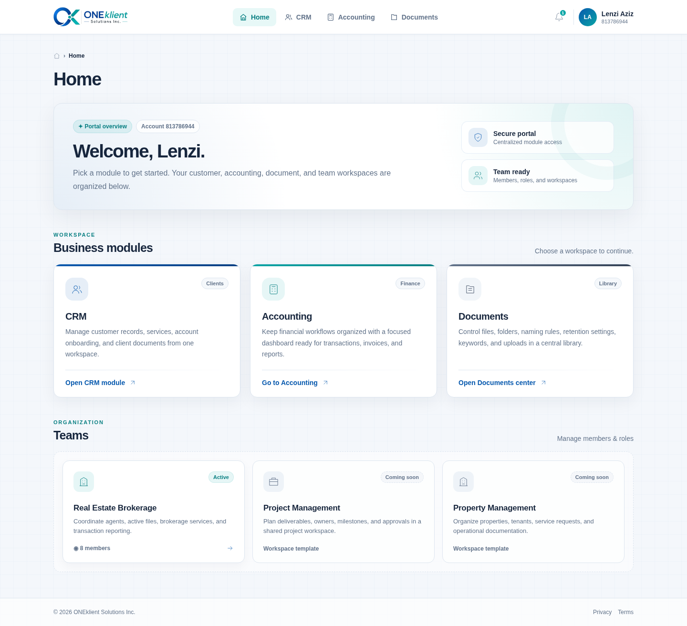

# ONEklient dashboard conversion

A responsive rebuild of the supplied ONEklient portal using:

- Next.js 14 App Router and TypeScript
- Tailwind CSS v4
- shadcn/ui-style components powered by Radix UI
- Lucide icons
- Production Node.js server support

The project preserves the source portal's main information architecture: Home, CRM, Accounting, Documents, and the Real Estate Brokerage team workspace. It also supplies polished starter screens for each route so backend services can be connected without redesigning the shell.

## Design preview



A mobile preview is included at `docs/preview-mobile.png`.

## Included routes

| Route | Purpose |
| --- | --- |
| `/` | Home dashboard with module and team cards |
| `/crm/` | CRM dashboard, services, account intake, and customer-document entry points |
| `/accounting/` | Accounting dashboard shell and integration-ready workspaces |
| `/documents/` | Defaults, keywords, folder browser, and upload interface |
| `/teams/real-estate/` | Real Estate Brokerage members, roles, and services |

## Requirements

- Node.js 20.9 or newer
- npm 10 or another current package manager

## Run locally

```bash
npm install
npm run dev
```

Open `http://localhost:3000/test/`.

## Production Node.js server

```bash
npm run build
npm start
```

`next build` writes the production application to `.next/`. `npm start` runs
`server.cjs`, which serves the real Next.js application at `http://localhost:3000/test/`.
The server reads `PORT` from the hosting environment automatically.

## Deployment path

The application uses `/test` by default, so the domain root does not expose the
site during testing. The production URL is `https://example.com/test/`.

To use a different path, set `BASE_PATH` to the same value while building and
running the server:

macOS/Linux:

```bash
BASE_PATH=/another-path npm run build
BASE_PATH=/another-path npm start
```

Windows PowerShell:

```powershell
$env:BASE_PATH="/another-path"
npm run build
$env:BASE_PATH="/another-path"
npm start
```

Set `server.cjs` as the Node.js application startup file in the hosting panel.
Upload the project files, install production dependencies, and run the build.
When `BASE_PATH` is not set, the application uses `/test`.

## Where to connect application logic

- Replace the presentation-only account menu actions in `components/app-header.tsx` with your authentication routes.
- Connect CRM forms and activity data in `app/crm/page.tsx`.
- Connect verified ledger data in `app/accounting/page.tsx`.
- Wire document defaults, search, folders, and upload handlers in `app/documents/page.tsx`.
- Replace sample team values and role entries in `app/teams/real-estate/page.tsx`.

## Design system

Brand tokens live in `app/globals.css`. The main values are:

```css
--brand-blue: #0759ae;
--brand-blue-deep: #063f82;
--brand-teal: #0aa5a5;
--brand-teal-deep: #087f82;
--brand-ink: #17263d;
--brand-surface: #f4f7fb;
```

Reusable primitives are in `components/ui/`, while portal-specific components are in `components/`.

## Notes

- The app is intentionally backend-agnostic. Buttons and form surfaces that need APIs are clearly isolated for integration.
- Production requests are served by Next.js through `server.cjs`; the project no longer generates or serves an `out/` directory.
- Replace `public/oneklient-logo.png` with your approved production logo asset when necessary.
